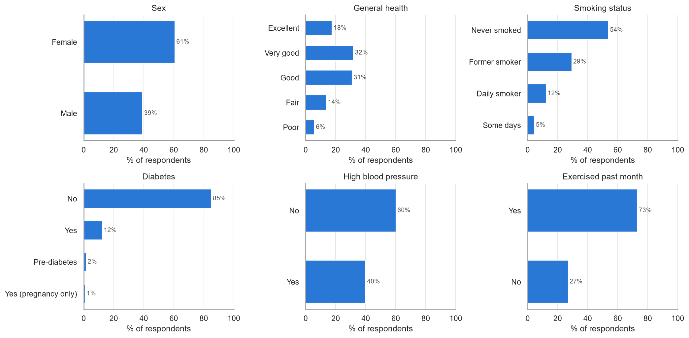
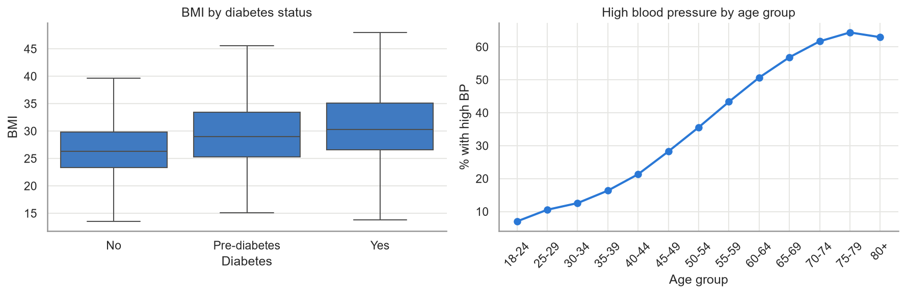
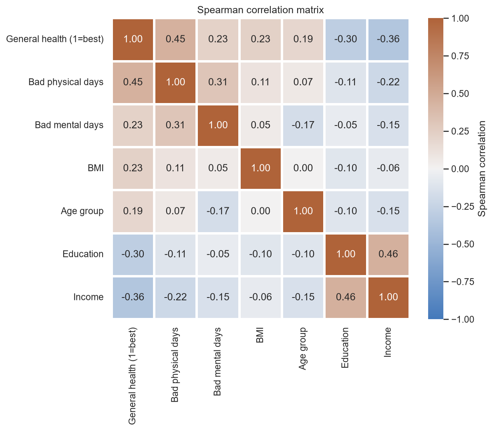
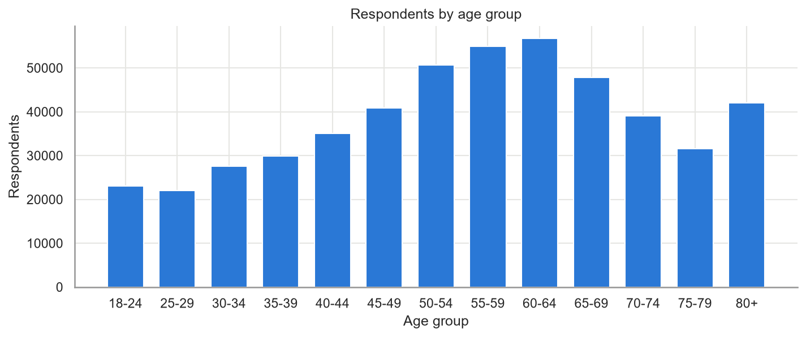

# Diabetes Prediction — BRFSS 2011

Exploratory analysis of the **BRFSS 2011** survey, the first step of a machine learning **classification** project that predicts whether a person has diabetes from their health indicators, lifestyle habits and demographic information.

## Dataset

The data comes from the **Behavioral Risk Factor Surveillance System (BRFSS) 2011**, a yearly telephone survey run by the U.S. Centers for Disease Control and Prevention (CDC).

- **Source:** [CDC — BRFSS 2011 annual data](https://www.cdc.gov/brfss/annual_data/annual_2011.html)
- **Size:** 506,467 respondents × 454 variables (about 730 MB, not included in this repository)
- **Coverage:** 53 U.S. states and territories (median of about 8,259 respondents per state), interviews from January 2011 to February 2012
- **Format:** one row per respondent. Answers are stored as numeric codes (see the codebook)

### Target variable: `DIABETE3`

| Code | Meaning | Respondents | Share |
|---|---|---:|---:|
| 3 | No diabetes | 429,062 | 84.7% |
| 1 | Diabetes | 62,461 | 12.3% |
| 4 | Pre-diabetes / borderline | 8,179 | 1.6% |
| 2 | Diabetes only during pregnancy | 4,828 | 1.0% |
| 7 / 9 / empty | Don't know / refused / missing | 1,937 | 0.4% |

The classes are **strongly imbalanced**, so this needs to be handled during modelling.

### Key features

| Column | Meaning |
|---|---|
| `_BMI5` | Body mass index (× 100) |
| `GENHLTH` | General health (1 = Excellent … 5 = Poor) |
| `PHYSHLTH` / `MENTHLTH` | Days of poor physical / mental health in the past 30 days |
| `_RFHYPE5` | High blood pressure |
| `CVDINFR4` | Heart attack ever |
| `_SMOKER3` | Smoking status |
| `EXERANY2` | Any exercise in the past month |
| `_AGEG5YR` | Age in 5-year groups |
| `SEX` | Sex |
| `_EDUCAG`, `_INCOMG` | Education level, income group |

## Exploratory data analysis

The full analysis is in [EDA_BRFSS_2011.ipynb](EDA_BRFSS_2011.ipynb). Main findings:

**Distribution of key categorical variables**, including the diabetes target:

**BMI is higher for diabetic respondents**, and high blood pressure increases steadily with age:

**Correlations between health indicators:**

**The survey leans toward older adults:**

### Data quality notes

- **About 54% of cells are empty.** Many questions come from optional modules, and 212 columns are more than 90% empty, so only a relevant subset of columns will be kept.
- **Special codes** such as `7`/`77` (don't know), `9`/`99` (refused) and `88` (none) must be recoded before modelling.
- **No duplicate rows.**
- Several columns are duplicates of each other (raw answer and derived version, e.g. `EDUCA` ↔ `_EDUCAG`, `EXERANY2` ↔ `_TOTINDA`, `HEIGHT3` ↔ `HTIN4` ↔ `HTM4`), so only one of each is kept.
- 63 interview dates (`IDATE`) are empty or unreadable.

## Getting the data

Download the 2011 BRFSS data from the [CDC website](https://www.cdc.gov/brfss/annual_data/annual_2011.html) and save it as `2011.csv` in the `BRFSS_2011/` folder. The file is excluded from Git by the `.gitignore` of the repository.
