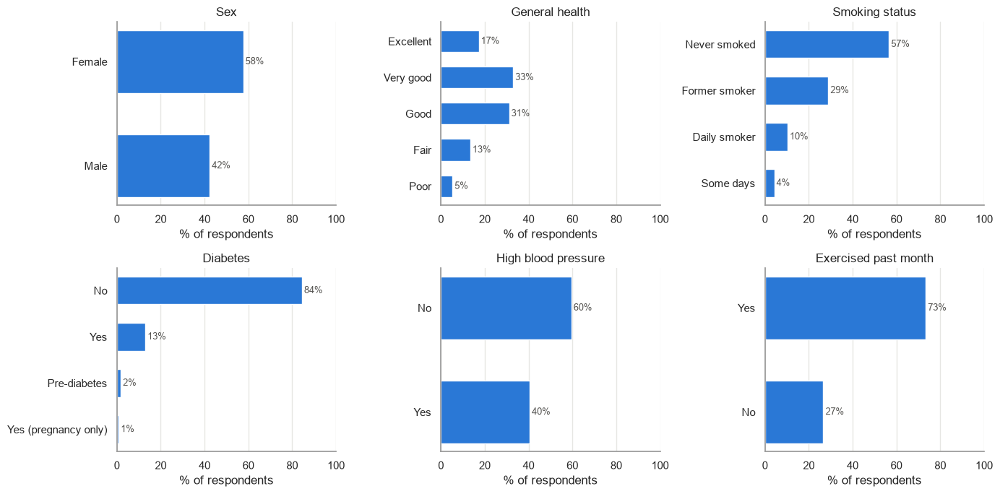
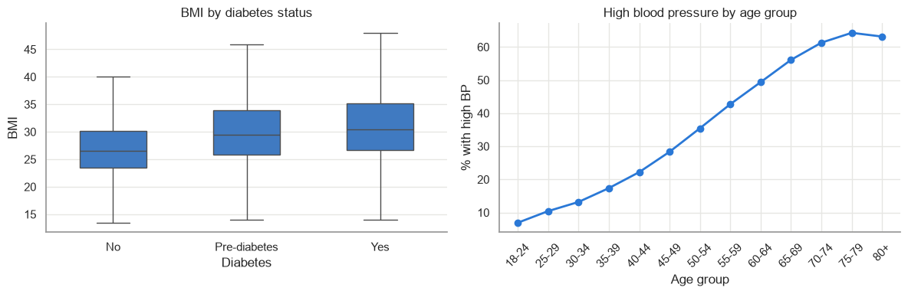
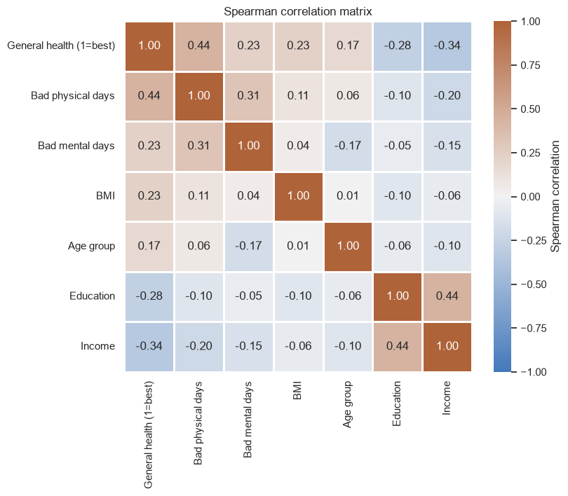
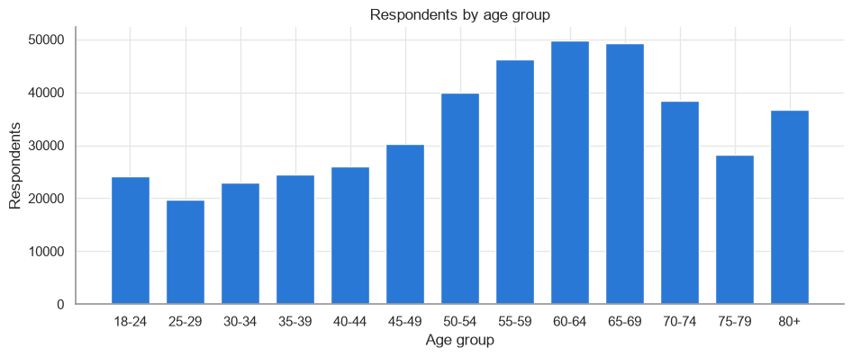

# Diabetes Prediction — BRFSS 2015

A machine learning **classification** project that predicts whether a person has diabetes from their health indicators, lifestyle habits and demographic information.

## Project goal

Diabetes is one of the most common chronic diseases in the United States, and many people who have it don't know it. The aim of this project is to build a model that tells, from a set of answers to a health survey, whether a respondent is likely to be **diabetic**, **pre-diabetic** or **healthy**. This kind of model can help with early screening.

## Dataset

The data comes from the **Behavioral Risk Factor Surveillance System (BRFSS) 2015**, a yearly telephone survey run by the U.S. Centers for Disease Control and Prevention (CDC).

- **Source:** [CDC — BRFSS 2015 annual data](https://www.cdc.gov/brfss/annual_data/annual_2015.html)
- **Size:** 441,456 respondents × 330 variables (about 500 MB, not included in this repository)
- **Coverage:** 53 U.S. states and territories, interviews from January 2015 to March 2016
- **Format:** one row per respondent. Answers are stored as numeric codes (see the codebook)

### Target variable: `DIABETE3`

| Code | Meaning | Respondents | Share |
|---|---|---:|---:|
| 3 | No diabetes | 372,104 | 84.3% |
| 1 | Diabetes | 57,256 | 13.0% |
| 4 | Pre-diabetes / borderline | 7,690 | 1.7% |
| 2 | Diabetes only during pregnancy | 3,608 | 0.8% |
| 7 / 9 / empty | Don't know / refused / missing | 798 | 0.2% |

The classes are **strongly imbalanced**, so this needs to be handled during modelling.

### Key features

| Column | Meaning |
|---|---|
| `_BMI5` | Body mass index (× 100) |
| `GENHLTH` | General health (1 = Excellent … 5 = Poor) |
| `PHYSHLTH` / `MENTHLTH` | Days of poor physical / mental health in the past 30 days |
| `_RFHYPE5` | High blood pressure |
| `CVDINFR4` | Heart attack ever |
| `_SMOKER3` | Smoking status |
| `EXERANY2` | Any exercise in the past month |
| `_AGEG5YR` | Age in 5-year groups |
| `SEX` | Sex |
| `_EDUCAG`, `_INCOMG` | Education level, income group |

## Exploratory data analysis

The full analysis is in [EDA_BRFSS_2015.ipynb](EDA_BRFSS_2015.ipynb). Main findings:

**Distribution of key categorical variables**, including the diabetes target:

**BMI is higher for diabetic respondents**, and high blood pressure increases steadily with age:

**Correlations between health indicators:**

**The survey leans toward older adults:**

### Data quality notes

- **About 45% of cells are empty.** Many questions come from optional modules, and 102 columns are more than 90% empty, so only a relevant subset of columns will be kept.
- **Special codes** such as `7`/`77` (don't know), `9`/`99` (refused) and `88` (none) must be recoded before modelling.
- **No duplicate rows.**
- Several columns are duplicates of each other (raw answer and derived version, e.g. `EDUCA` ↔ `_EDUCAG`), so only one of each is kept.

## Getting the data

Download the 2015 BRFSS data from the [CDC website](https://www.cdc.gov/brfss/annual_data/annual_2015.html) and save it as `2015.csv` in the project root. The file is excluded from Git by [.gitignore](.gitignore).
